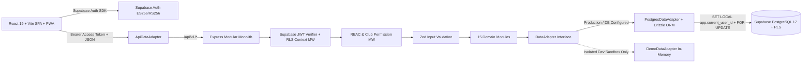

# CampusVerse

Centralized college clubs, events, custom registration forms, controlled batch ticket release, single-use camera QR attendance verification, post-event reporting, integer-paise financial management, and institutional administration platform.

> **Phase 5 Complete**: Modular monolith powered by React 19 + TypeScript + Vite 8 + Tailwind CSS 4, Express 4 (`/api/v1/*`), Supabase Auth (`ES256` JWKS), Supabase PostgreSQL 17 + Drizzle ORM (21 tables, 4 migrations, Row-Level Security via restricted `campusverse_app` runtime role), TanStack Query, Workbox PWA, and `html5-qrcode`.

---

## 1. System Architecture



### Architectural Invariants
1. **Authoritative Express API**: The React client never queries business tables directly via Supabase Data API (`supabase.from(...)`). `@supabase/supabase-js` is used strictly for authentication.
2. **Restricted Runtime Database Role**: All runtime traffic runs through `campusverse_app` (`NOSUPERUSER`, `NOBYPASSRLS`) using transaction-local `set_config('app.current_user_id', ..., true)` RLS context.
3. **Separated Registration & Ticket Lifecycle**: Registrations begin with `ticketStatus = 'not_released'` and no usable QR secret; tickets unlock strictly after an authorized organizer executes batch ticket release (`POST /api/v1/events/:eventId/tickets/release`).
4. **No Plaintext QR Secrets in Tables**: Tickets store SHA-256 `token_hash` for verification and AES-256-GCM `sealed_token` for authorized participant retrieval.
5. **Integer Minor-Unit Finance**: All club and event ledger math uses integer paise (`amount_minor_units` / `bigint`), avoiding floating-point rounding drift.

---

## 2. Project Directory Structure

```text
├── drizzle/                         # Generated SQL migrations (0000..0003 + meta journal)
├── public/                          # PWA icons, manifest assets, static attachments
├── shared/                          # Shared constants, permissions, TypeScript DTOs, Zod schemas
├── server/
│   ├── adapters/                    # DataAdapter interface, PostgresDataAdapter, DemoDataAdapter
│   ├── config/                      # Environment validation & business constants
│   ├── db/                          # Drizzle schema (21 tables), RLS SQL, pool, seed & test scripts
│   │   └── repositories/            # Modular Drizzle repositories
│   ├── middleware/                  # Auth/JWKS, club RBAC, Zod validation, rate limits, request logger
│   ├── modules/                     # 15 domain modules (auth, users, clubs, memberships, invitations,
│   │                                # hall-of-fame, events, forms, registrations, tickets, attendance,
│   │                                # reports, finance, notifications, admin)
│   ├── shared/                      # AppError hierarchy, API responses, crypto/CSV helpers, mailer
│   └── app.ts                       # Express app factory (/api/v1/health, /health/ready, domain routes)
├── server.ts                        # Port 3000 HTTP server (Vite middleware in dev, static dist in prod)
├── src/
│   ├── adapters/                    # ClientDataAdapter & ApiDataAdapter
│   ├── components/                  # AppShell + header role switcher, QR scanner, guards, UI primitives
│   ├── context/                     # AuthContext, ToastContext
│   ├── hooks/                       # Debounce & helper hooks
│   ├── lib/                         # Supabase client & download helpers
│   └── pages/                       # Public, Student, Club Admin / Core Member, Super Admin views
├── tests/
│   ├── backend/                     # Vitest + Supertest API tests & live PostgreSQL RLS integration tests
│   ├── frontend/                    # React Testing Library component & workflow tests
│   └── e2e/                         # Playwright browser E2E verification suite
└── docs/                            # Detailed API contracts, DB, security, testing, and operations runbook
```

---

## 3. Database & Migration Commands

```bash
npm run db:generate    # Generate Drizzle SQL migrations from server/db/schema.ts
npm run db:migrate     # Apply SQL migrations using DATABASE_MIGRATION_URL
npm run db:rls         # Apply triggers, RLS policies, and campusverse_app least-privilege role
npm run db:seed        # Seed idempotent institutional catalog & system_settings
npm run db:seed:test   # Provision non-production test dataset & Supabase test accounts (when service-role key configured)
npm run db:reset:test  # Remove ONLY non-production test fixtures & test accounts
npm run db:status      # Inspect applied migrations, row counts, RLS flags, and runtime role privileges
```

---

## 4. Local Development, Testing & Build

```bash
npm install
npm run dev            # Express + Vite middleware on http://localhost:3000
npm run lint           # TypeScript strict check (tsc --noEmit)
npm run build          # Production Vite + Workbox PWA bundle
npm test               # Vitest API, frontend RTL, and live PostgreSQL RLS integration suites
npm run test:e2e       # Playwright Chromium E2E tests
```

---

## 5. Documentation Index

- **[API Contracts](docs/API_CONTRACTS.md)** — All `/api/v1/*` endpoints, permissions, request/response schemas, and examples.
- **[Database Architecture](docs/DATABASE.md)** — 21-table Drizzle schema, relationships, migrations (`0000`–`0003`), RLS, triggers, and backup/recovery.
- **[Security Architecture & Credentials](docs/SECURITY.md)** — JWT/JWKS, RLS, QR & CSV safety, and full credential governance & rotation table.
- **[Operations Runbook](docs/OPERATIONS_RUNBOOK.md)** — End-to-end workflows (clubs, Instagram, events, forms, tickets, camera QR scanner, reports, finance, Super Admin, SMTP, test credentials, deployment, troubleshooting).
- **[Development Guide](docs/DEVELOPMENT.md)** & **[Testing Strategy](docs/TESTING.md)** & **[Phase Roadmap](docs/PHASE_ROADMAP.md)**.
