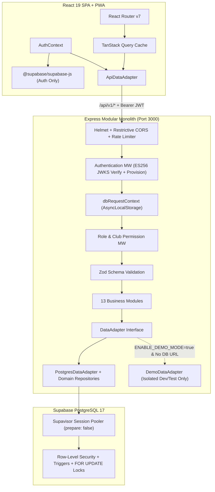

# System Architecture

CampusVerse follows a **modular monolith** architecture with strict separation between HTTP transport, business logic, database privilege boundaries, and persistence adapters.

## Request Lifecycle

`Request → Router → Supabase JWT Verify → AsyncLocalStorage RLS Context → RBAC/Club Permission Check → Zod Input Validation → Controller → Service → PostgresDataAdapter → Transaction (SET LOCAL app.current_user_id / app.current_global_role) → Standardized JSON Response`

## Adapter Selection Rules

- **Production (`NODE_ENV === 'production'`)**: Requires `DATABASE_URL` (restricted `campusverse_app` role) and `SUPABASE_URL`; fails fast on startup if missing.
- **Development with DB configured**: Uses `PostgresDataAdapter` (`DATABASE_URL` preferred, `DATABASE_MIGRATION_URL` permitted locally until `DATABASE_URL` is added).
- **Isolated Demo Sandbox**: Active **only** when `NODE_ENV !== 'production' && ENABLE_DEMO_MODE === 'true'` AND no PostgreSQL URL is present (or inside isolated Vitest unit tests injecting `DemoDataAdapter`). No silent fallback from PostgreSQL errors to demo mode ever occurs.
