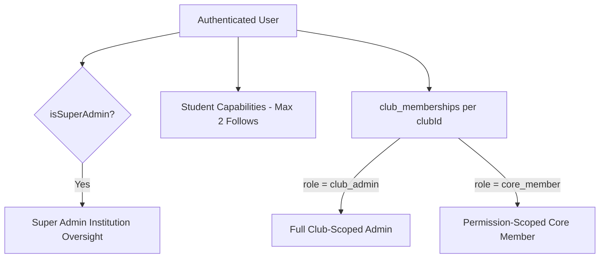

# Authorization & Multi-Club Context Model

CampusVerse models roles as **contextual memberships**, not mutually exclusive global roles.

## Business Rules Enforced Across API & PostgreSQL

| Rule | API / Service Enforcement | PostgreSQL RLS & Trigger Enforcement |
| :--- | :--- | :--- |
| Max 2 followed active clubs | `MembershipsService` + `CLUB_NOT_ACTIVE` (`422`) | `users` `FOR UPDATE` lock + `sync_club_follower_count` trigger |
| Multi-club memberships | `club_memberships` array per `clubId` | `UNIQUE(user_id, club_id)` + `app_is_club_member` / `app_is_club_admin` RLS |
| Club Admin assignment | Super Admin only (`403` for Club Admins) | `prevent_club_admin_membership_escalation` trigger |
| Club status lifecycle | Super Admin only (`PATCH /clubs/:clubId/status`) | `prevent_club_privilege_escalation` trigger (`clubs.status` & `follower_count`) |
| Core Member permission-scoped | `requireEventPermission` | RLS + permission JSONB check |
| Financial data hidden from students | `SUBMIT_FINANCE_REPORTS` / Super Admin only | RLS blocking student SELECT on `finance_reports` |
| Single-use QR attendance | `recordAttendance` conflict check | `UNIQUE(registration_id)` on `attendance_records` |
