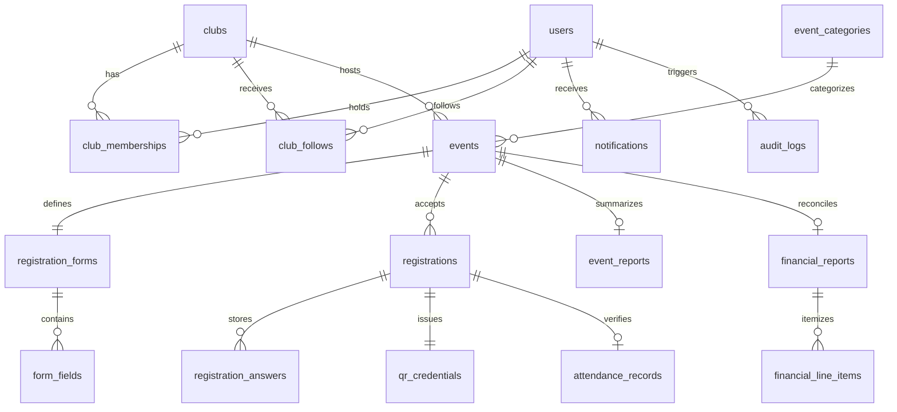

# Database Integration Plan (Phase 2 Specification)

> **Phase 1 Boundary**: No database migrations, SQL executions, or Supabase provisioning are executed in Phase 1. This document defines the exact Phase 2 PostgreSQL + Drizzle ORM schema target.

## Entity Specifications (17 Entities)

1. **`users`**: Core identity mapped 1:1 with Supabase `auth.users.id`.
   - Fields: `id (uuid PK)`, `email (text UNIQUE)`, `name (text)`, `department (text)`, `year_of_study (text)`, `student_id (text UNIQUE)`, `is_super_admin (boolean DEFAULT false)`, `status (enum)`, `email_verified (boolean)`, `created_at (timestamptz)`.
   - Indexes: `idx_users_email`, `idx_users_status`. Access: Self read/update (except `is_super_admin`/`status`); Super Admin read/status-update. Retention: Institutional lifecycle.

2. **`clubs`**: Student organizations.
   - Fields: `id (uuid PK)`, `name (text)`, `slug (text UNIQUE)`, `category (text)`, `tagline (text)`, `description (text)`, `logo_url (text)`, `status (enum)`, `founded_year (int)`, `meeting_schedule (text)`, `contact_email (text)`, `created_at (timestamptz)`.
   - Indexes: `idx_clubs_status_category`. Access: Public read for `active`; Club Admin update own club; Super Admin full oversight.

3. **`club_memberships`**: Scoped officer roles & permissions per club.
   - Fields: `id (uuid PK)`, `user_id (uuid FK -> users)`, `club_id (uuid FK -> clubs)`, `role (enum: club_admin, core_member)`, `title (text)`, `permissions (jsonb)`, `joined_at (timestamptz)`.
   - Constraints: `UNIQUE(user_id, club_id)`. Indexes: `idx_memberships_user`, `idx_memberships_club`.

4. **`club_follows`**: Student club subscriptions.
   - Fields: `id (uuid PK)`, `user_id (uuid FK -> users)`, `club_id (uuid FK -> clubs)`, `followed_at (timestamptz)`.
   - Constraints: `UNIQUE(user_id, club_id)` + PostgreSQL trigger/transaction enforcing `COUNT(*) <= 2` per `user_id`.

5. **`event_categories`**: Canonical event taxonomy (`id`, `slug UNIQUE`, `label`, `created_at`).

6. **`events`**: Club-hosted activities.
   - Fields: `id (uuid PK)`, `club_id (uuid FK -> clubs)`, `category_id (uuid FK -> event_categories)`, `title (text)`, `description (text)`, `venue (text)`, `start_time (timestamptz)`, `end_time (timestamptz)`, `registration_deadline (timestamptz)`, `capacity (int)`, `status (enum)`, `is_paid (boolean)`, `fee_amount (numeric)`, `created_at`, `updated_at`.
   - Indexes: `idx_events_club_status`, `idx_events_start_time`.

7. **`registration_forms`**: Versioned intake form headers (`id PK`, `event_id FK UNIQUE`, `version int`, `updated_at`).

8. **`form_fields`**: Ordered field definitions (`id PK`, `form_id FK`, `label`, `type`, `required`, `placeholder`, `options jsonb`, `sort_order int`).

9. **`registrations`**: Student-event enrollment (`id PK`, `event_id FK`, `student_id FK`, `form_version int`, `status enum`, `created_at`).
   - Constraints: `UNIQUE(event_id, student_id)`.

10. **`registration_answers`**: Normalized per-field responses (`id PK`, `registration_id FK`, `field_id FK`, `value_json jsonb`).

11. **`qr_credentials`**: Non-PII opaque check-in tokens (`id PK`, `registration_id FK UNIQUE`, `event_id FK`, `token_hash text UNIQUE`, `issued_at`, `used_at`).

12. **`attendance_records`**: Immutable check-in ledger (`id PK`, `event_id FK`, `registration_id FK UNIQUE`, `checked_in_by FK -> users`, `method enum`, `checked_in_at`).
    - Unique `registration_id` enforces single-use attendance at the database layer.

13. **`event_reports`**: Post-event completion outcomes (`id PK`, `event_id FK UNIQUE`, `club_id FK`, `submitted_by FK`, `outcome_summary`, `highlights`, `challenges`, `actual_attendance int`, `completion_status enum`, `submitted_at`).

14. **`financial_reports`**: Private club event financial headers (`id PK`, `event_id FK UNIQUE`, `club_id FK`, `submitted_by FK`, `total_collections numeric`, `total_expenses numeric`, `net_balance numeric`, `notes`, `submitted_at`).
    - Access: Strictly blocked for general students via RLS & Express authorization.

15. **`financial_line_items`**: Itemized collection/expense entries (`id PK`, `financial_report_id FK`, `type enum`, `label`, `category`, `amount numeric`, `notes`).

16. **`notifications`**: User-scoped activity alerts (`id PK`, `user_id FK`, `title`, `message`, `category`, `read boolean`, `link`, `created_at`).

17. **`audit_logs`**: Append-only compliance trail (`id PK`, `actor_id FK`, `actor_context`, `action`, `target_type`, `target_id`, `details`, `created_at`). Retention: 7-year institutional archive.
